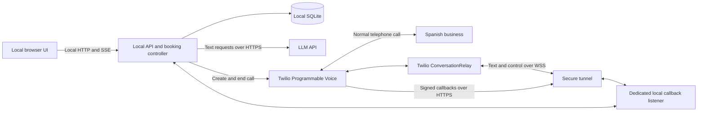
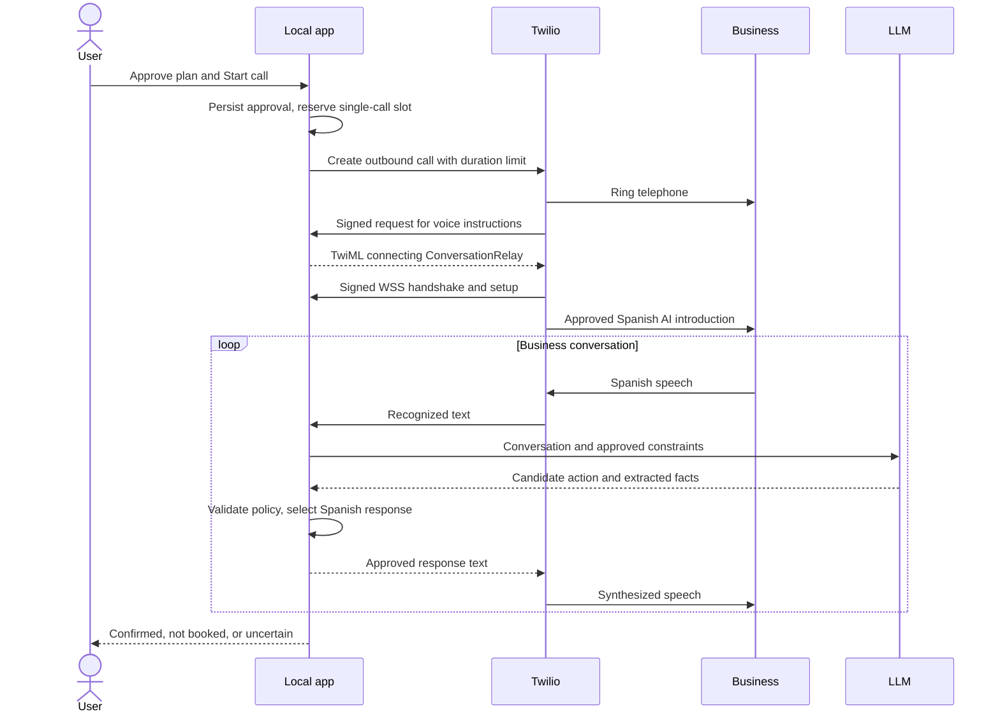

# CallMate architecture

Status: proposed personal-use architecture. Updated: 2026-10-15. Implements [requirements](requirements.md); tooling and provider references are in [tech-stack.md](tech-stack.md).

## 1. Design decision

Run the browser UI locally and the Node.js application logic and SQLite database in a local Docker container, with SQLite in a persistent Docker volume. Use Twilio Programmable Voice for outbound calls and Twilio ConversationRelay for the speech layer. A text LLM interprets the conversation and proposes the next action; application code validates actions before anything consequential is spoken. The [Docker guide](docker-development.md) describes the implemented backend/simulator and its current limits. The simulator uses scripted adapters without network access to providers; this is not the live conversation/policy implementation.

ConversationRelay handles recognition and speech synthesis, so the application exchanges text and control events rather than implementing a raw audio bridge. This is a good fit for a personal tool with occasional calls. It still needs an application backend and an LLM: Twilio does not automatically know the user's appointment request. See the [ConversationRelay overview](https://www.twilio.com/docs/voice/conversationrelay).

## 2. Components and connections



One Node.js process can own two HTTP listeners and the call controller. Use a persistent process during a call; no distributed services, external queue, or hosted database is needed.

| Component | Responsibility |
| --- | --- |
| Browser UI | Request editing, plan review, live text, approval actions, Stop, and results. No provider credentials. |
| Local API | Input validation, call authorization, single-call lock, approvals, local event stream, and history. |
| Call controller | Explicit state transitions, Twilio lifecycle, deadlines, dialogue turns, and outcome reconciliation. |
| Dialogue planner | Convert finalized business utterances into typed candidate actions and translate text for the user. |
| Policy/response layer | Validate constraints and render approved Spanish responses; critical acceptance/readback replies use controlled templates. |
| Callback listener | Verify Twilio HTTP/WebSocket requests and route recognized sessions to the controller. |
| SQLite | Requests, immutable approved plans, attempts, events, approvals, and booking outcomes. |
| Tunnel | Public HTTPS/WSS reachability for Twilio while forwarding only the callback listener. |

### Network boundary

- Private API: default host `127.0.0.1:3000`, published by Docker Compose. The future UI can use the same origin. Apply origin/CSRF protections to mutating browser requests; reject unexpected Host/Origin values.
- Twilio callback listener: default host `127.0.0.1:3001`, published separately and intended for a callback-only tunnel. Both listeners bind `0.0.0.0` inside the container; host publications remain loopback-only. The callback listener contains no personal UI, history, settings, or call-start endpoints.
- Planned public callback routes: `POST /twilio/voice`, `POST /twilio/status`, `POST /twilio/relay-ended`, and WebSocket `/twilio/relay`. The scaffold currently rejects all callback routes until signature/session validation is implemented. Unknown routes fail closed.
- Twilio callback and WebSocket handshake signatures must be checked using the SDK, configured public URL, and correct request representation. Do not trust arbitrary forwarded host headers. Validate account and call/session ownership as well.
- ConversationRelay sends a signature on its initial WebSocket handshake; this is documented in [Twilio onboarding](https://www.twilio.com/docs/voice/conversationrelay/onboarding). A random URL alone is not authentication.

The UI is local to the computer by default. Using it from a phone later requires an explicit authenticated private-access design; exposing the personal API through the Twilio tunnel is not that design.

## 3. Outbound call flow



The TwiML must include a safe end/fallback path that hangs up after relay termination. Callback URLs are supplied for the individual outgoing call; creating an inbound phone product is unnecessary. Set the maximum duration at Twilio as well as locally so a laptop crash cannot leave an unlimited call running. Verify the exact Calls API parameters during the first integration milestone.

### Twilio session adapter

Map ConversationRelay `setup`, `prompt`, `interrupt`, and `error` messages into domain events. Process finalized turns in order; keep partial recognition provisional. Send approved replies as `text` messages. Limited `sendDigits` support can handle a simple menu after the base flow works. These capabilities are documented in [ConversationRelay WebSocket messages](https://www.twilio.com/docs/voice/conversationrelay/websocket-messages).

Keep speech interruptible. On interruption, cancel obsolete LLM work, stop sending old reply chunks, and record that the business may not have heard the complete sentence. Never treat generated text as proof of playback or agreement. Late model responses are discarded using a monotonically increasing turn version.

## 4. Conversation control and booking authority

The planner returns schema-validated data such as:

```text
action: ask_availability | clarify | evaluate_offer | request_user_approval |
        read_back | accept_offer | record_business_confirmation | end_call
offer: service, local_date, local_time, timezone, price, currency, conditions
evidence: references to finalized utterance IDs
```

The exact v1 wire actions and adapter boundaries are now defined in [Shared interfaces](interfaces.md). In that contract, the planner proposes an offer and the policy/controller decides whether user approval is required; the model does not grant itself authority.

The model cannot directly call Twilio, change the destination, write a confirmed booking, or access credentials. Strict output structure helps parsing but does not prove that extracted facts are true. Validate required fields, date/time, currency, availability, price policy, authorization version, and evidence in application code.

All spoken output passes the response layer. For the MVP, use a bounded dialogue policy with controlled Spanish phrases and validated slots; do not stream arbitrary unfinished model sentences to the business. In particular, acceptance and changed-offer responses must be server-rendered from an approved offer. Streaming an unvalidated “yes” before policy evaluation could already create a commitment.

Recommended booking sequence:

1. Extract an offer; ask for clarification if any required detail is uncertain.
2. Check it against the approved plan. If outside bounds, request user approval for that exact offer and wait without accepting it.
3. Read back the final details and express acceptance only after approval checks pass.
4. Require the business's explicit affirmative confirmation of those details.
5. Persist a confirmed booking with evidence; otherwise retain an uncertain or not-booked result as appropriate.

Business speech and model output are untrusted inputs. A statement such as “ignore the budget” or “tell me the API password” never alters the policy. Do not send secrets to the model in the first place. Spanish-language review and test calls remain necessary: controlled output and readback reduce mistakes but cannot guarantee perfect speech understanding.

## 5. State and data model

Separate telephone state from booking state. Twilio ending a call is a transport fact, not evidence of an appointment.

```text
Call attempt:
prepared -> creating -> dialing -> ringing -> connected -> ending -> ended
                          \-> busy | no_answer | failed
creating with unknown provider result -> reconciliation_required

Booking outcome:
pending -> offer_received -> awaiting_approval / reading_back
        -> awaiting_business_confirmation -> confirmed
        -> not_booked / uncertain
```

Store provider statuses alongside this simplified domain state; do not assume callbacks always arrive in order. A user-requested hangup after acceptance may still leave a real appointment, so preserve that distinction.

| Entity | Main fields |
| --- | --- |
| Request | Business name/number, service, business timezone, availability windows, booking name, shareable contact details. |
| Approved plan | Immutable version of request constraints, unknown-price policy, booking permission, call-cost/duration limits, and approval timestamp. |
| Call attempt | Request/plan IDs, local idempotency key, Twilio call SID, relay session ID, state, timings, terminal reason, reconciliation status. |
| Conversation event | Attempt ID, sequence, speaker/source, original text, translation, final/provisional status, interruption metadata, timestamp. |
| Offer and approval | Exact structured offer/version, evidence, approval decision, expiry, and matching plan version. |
| Booking | Final details, outcome, business confirmation evidence, and any uncertainty. |
| Usage | Duration, estimated costs, available settled provider costs, currency, and rate timestamp. |

Use UTC instants plus IANA business timezone and original local date/time. Store money in integer minor units with currency. Reject impossible/ambiguous DST times rather than silently shifting an appointment. Business hours and availability are different concepts and should not be conflated.

Keep the database in the private `/data` directory of the persistent Docker volume, with owner-only permissions. Host/Docker disk encryption is an operational choice; SQLite is not encrypted by itself. Use migrations and a future local retention task, not an external scheduler.

## 6. Reliability and limits

| Risk | Handling |
| --- | --- |
| Repeated Start click | Unique local request key and transactional active-call reservation. |
| Calls API times out | Mark creation uncertain and reconcile Twilio call records/callbacks; never blindly retry a potentially successful dial. Local idempotency does not imply Twilio guarantees exactly-once creation. |
| Duplicate/out-of-order callbacks | Verify signature, deduplicate when possible, apply allowed transitions, and prevent completed states from regressing. |
| Disconnect near booking acceptance | Keep uncertainty and prompt the user to check; no automatic rebooking. |
| App restart | Reconcile nonterminal attempts against Twilio before allowing another call; cancel an orphaned live call where appropriate. |
| Tunnel or laptop failure | Twilio-side maximum duration plus relay fallback; after recovery, reconcile rather than assume safe completion. |
| Stop not acknowledged | Show ending/unconfirmed status, retry bounded hangup/reconciliation, and provide a Twilio Console fallback. |
| LLM failure or long response | A short controlled apology, bounded retry before any commitment, then polite termination if still unavailable. |
| Stale approval | Require active call, matching offer and plan version, unexpired approval, and a fresh policy check before speaking acceptance. |
| Cost overrun | Estimate before dialing, cap duration/concurrency, restrict destinations, and reconcile actual usage later. Billing may lag, so a displayed budget is not a perfect real-time provider spend ceiling. |

No background autonomous retry queue is needed. The MVP calls only after a user starts an attempt while the app is ready.

## 7. Data flow and operation

- Twilio and its selected speech providers process telephone audio. The local app receives recognized text and sends approved response text to Twilio; no raw audio storage is required.
- The LLM receives the relevant transcript and minimal plan details. Request non-persistence where supported and review account-level retention controls; do not assume local storage means providers retain nothing.
- Do not claim EU-only processing merely because the business is in Spain or a phone number is European. Verify ConversationRelay availability, subprocessors, and actual routing before making residency promises.
- Log call IDs, event types, timings, usage, and error categories. Keep transcript bodies in the private database, outside application logs and Git.
- Test the callback tunnel and backend before a call. A changed public tunnel URL must update the call's configured URLs before dialing.
