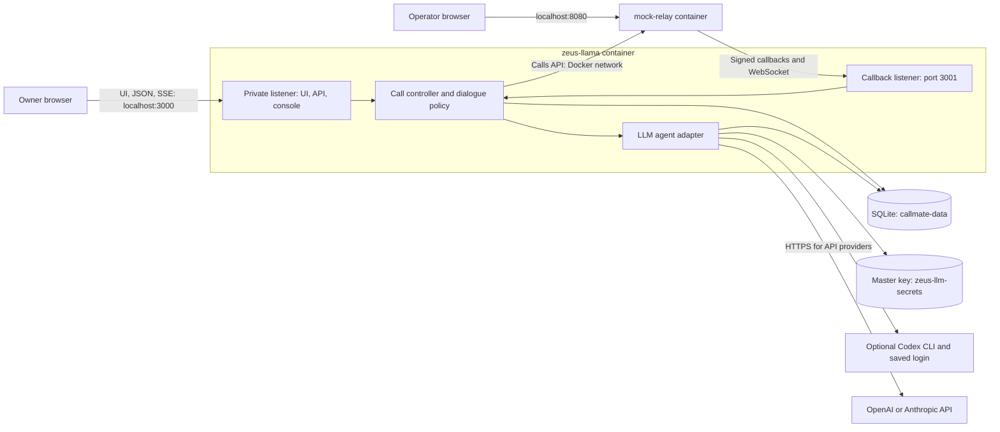
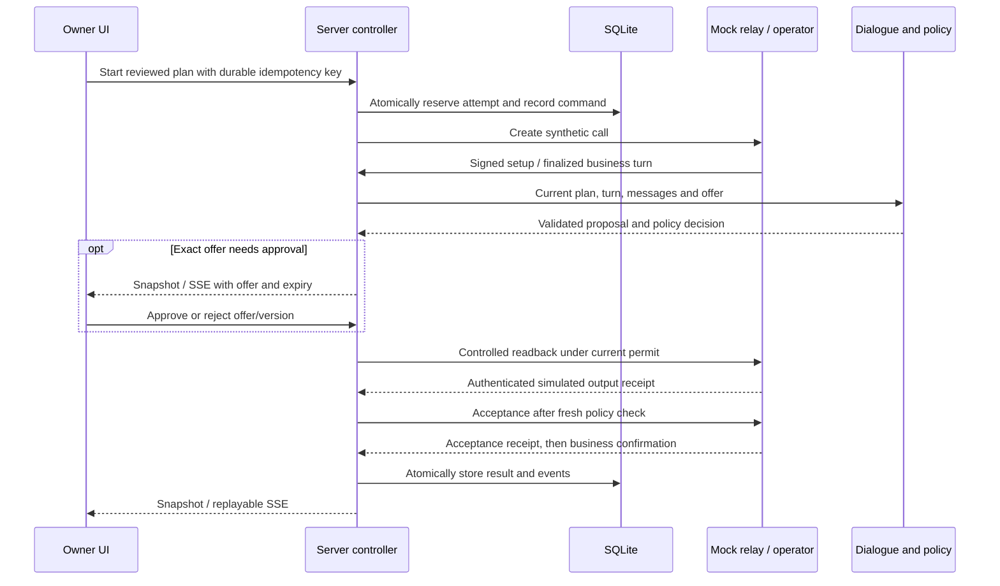

# Zeus Llama architecture

Status: current implementation, updated 2026-10-16. Repository and package names still use CallMate. Real telephone calling is not implemented; current call transports are simulations. Executable [contracts](../packages/contracts/src/index.ts) take precedence over documentation examples.

## 1. Runtime and deployment

The default [Compose stack](../compose.yaml) starts two containers. **`zeus-llama`** runs one Node.js process serving the compiled React UI, private HTTP/SSE API, technical console and a separate callback listener. **`mock-relay`** runs the independent ConversationRelay emulator and operator UI. There is no separate production frontend container or database server.



Host ports bind to `127.0.0.1`; listeners bind to `0.0.0.0` inside containers. Defaults are 3000 (app/API), 3001 (callbacks), and 8080 (operator). Containers use Docker DNS names `zeus-llama` and `mock-relay`; `server` remains a compatibility alias. No public tunnel is needed for local mock calls.

The optional `dev` profile adds Vite on port 5173 with an API proxy. The `checks` profile runs offline checks. [The Codex override](../compose.codex.yaml) selects an image containing Codex CLI and adds its persistent ChatGPT login volume; the base runtime image does not contain the CLI. See [Docker setup](docker-development.md) for commands and configuration.

## 2. Independent mode and provider selections

| Choice | Storage and behavior |
| --- | --- |
| Browser **Simulator / Backend** | Browser preference selects the scripted local client or HTTP/SSE client. Browser Simulator keeps call history locally and does not invoke the server call controller or LLM. Authentication, contacts and server LLM/call-engine settings still use the backend. |
| Settings → **Call engine** | SQLite stores `mock` (default) or `twilio`. Mock uses the configured local development transport, or the legacy scripted backend when `TELEPHONY_PROVIDER=fake`. Twilio is explicitly unavailable: new Backend Starts return `503 PROVIDER_NOT_READY`, without a provider request, reservation or fallback. |
| Settings → **LLM agent** | SQLite stores `disabled`, `codex`, `openai` or `anthropic`, plus model and effort. Saved settings override environment bootstrap values. The agent resolves an adapter for subsequent turns without a server restart. |

The server currently requires `CALLMATE_MODE=simulator`. Network mock transport also requires development/test gates and `TELEPHONY_PROVIDER=mock`; disabling these gates cannot silently enable scripted success. Reviewed mock calls require a ready dialogue engine. Manual console conversations exercise transport and carry no automated booking authority. Calls created directly in the operator UI are separate ephemeral greeting/echo checks.

Call-engine and LLM/key changes return `409 CALL_ALREADY_ACTIVE` while an attempt holds the active reservation, including ending or unresolved recovery. Stop, history, recovery and idempotent replay of existing commands remain available independently of new Start readiness.

## 3. Packages and controller boundaries

```text
apps/web          → packages/contracts
apps/server       → packages/contracts + packages/dialogue
packages/dialogue → packages/contracts
mock-conversation-relay: independent package and container
```

| Component | Responsibility |
| --- | --- |
| [Web UI](../apps/web/README.md) | Owner login, contacts, request/review/call/summary, settings, history, Agreements list/calendar and `.ics` export; HTTP/SSE client and browser simulator. |
| [Contracts](../packages/contracts/src/index.ts) | Zod schemas, HTTP definitions, event envelopes, types, adapter ports and synthetic fixtures; no provider side effects. |
| [Dialogue](../packages/dialogue/README.md) | Structured proposals, policy/reducers, controlled multilingual responses, templates, model adapters and offline evaluation; no database or dialing authority. |
| [server.ts](../apps/server/src/server.ts) | Runtime composition, listeners, authentication, private routes, error boundaries and lifecycle. |
| [call-controller.ts](../apps/server/src/call-controller.ts) | One public lifecycle facade over persisted scripted attempts and development mock conversations. |
| [development-conversations.ts](../apps/server/src/development-conversations.ts) | Mock preflight/create, correlation, active reservation, deadlines, Stop and recovery/reconciliation. |
| [relay-dialogue.ts](../apps/server/src/relay-dialogue.ts) | Current-turn checks, offers, exact-offer approvals, playback permits/receipts and booking transitions. |
| [mock-relay.ts](../apps/server/src/mock-relay.ts), [mock-status.ts](../apps/server/src/mock-status.ts), [mock-calls-client.ts](../apps/server/src/mock-calls-client.ts) | Signed local transport, bounded protocol parsing, status callbacks and SDK-compatible mock Calls requests. |
| [llm-agent.ts](../apps/server/src/llm-agent.ts), [llm-secrets.ts](../apps/server/src/llm-secrets.ts), [call-engine.ts](../apps/server/src/call-engine.ts) | Saved selection, encrypted credentials, adapter resolution and call-engine gate. |
| [Twilio harness](twilio-mock.md) | Offline REST/TwiML/WebSocket checks and reusable protocol schemas; no live Twilio adapter. |
| [Standalone mock](../mock-conversation-relay/README.md) | Calls API subset, synthetic destinations/IDs, signed callbacks, relay sessions and operator UI; sessions are in memory. |

Technical console assets in `apps/server/src/web` are distinct from the React application; both are served by the private listener.

## 4. Reviewed mock conversation and authority

The approved plan is immutable and binds destination, service/task, language, availability, shareable contact data, booking permission and limits. The browser reviews a server-normalized plan before Start; plan creation does not initiate a call.



The model returns structured candidate actions, facts and evidence references. It cannot dial, write bookings, grant approval, select an executable/endpoint or read credentials. The controller rechecks attempt/turn/plan/offer after asynchronous work and owns playback permits. Generated text, a user approval click, and an ended call are insufficient proof of a booking.

Controlled responses support **Spanish, Russian, English and Polish** across **15 templates**. Versioned phrases persist in SQLite; transcripts retain rendered speech and English translations. Spoken dates/times omit IANA names and UTC offsets; structured plans retain zone/instant. The haircut flow supplies the approved booking name and callback number instead of asking for the caller's identity or reciting a fee questionnaire; explicitly prohibited charges still cannot bypass policy.

In-plan offers can proceed through controlled readback and acceptance. Out-of-plan offers need an authenticated, unexpired grant for that exact offer/plan. Changed offers, intervening speech, interruption and Stop invalidate obsolete work. Reject sends a controlled closing and requests hangup; failure retains the reservation until termination is established.

Mock acceptance uses **simulated text playback receipts**, then separate affirmative business evidence checked by the bounded multilingual [confirmation matcher](../apps/server/src/mock-confirmation.ts). Contextual “Yes, I confirm” / “I already confirmed that” replies do not require endless repetition. Negation, corrections and uncertainty cannot establish confirmation. These checks are not attested real audio playback or a production semantic verifier. Results/calendar exports remain labelled as simulations.

Generic Ask/Change/Other tasks use findings and follow-up results, separate from appointment confirmation. The library's add-on/contact-consent helpers do not imply every helper is wired to a provider flow. See [dialogue integration](../packages/dialogue/INTEGRATION.md) for authority and teardown rules.

## 5. Persistence and data lifecycle

SQLite uses `better-sqlite3`, WAL, foreign keys and a 5-second busy timeout. Directory permissions are `0700`, database `0600`. Migrations **001–008** run transactionally with stored checksums; applied SQL is not silently rewritten.

| Tables | Contents |
| --- | --- |
| `schema_migrations`, `app_settings` | Migration history and general settings. |
| `review_plans` | Versioned reviewed requests. |
| `call_attempts` | Public snapshots and internal provider/controller state, deadlines and active reservation; a unique partial index permits one active attempt. |
| `call_events`, `commands` | Ordered replay events and durable command/idempotency records. |
| `contacts` | Shared address book; selecting a contact copies values into a plan, so later edits do not mutate approved calls. |
| `auth_owner`, `auth_sessions`, `auth_rate_limit` | Owner password verifier, sessions and persistent login/setup throttling. |
| `dialogue_phrases` | Versioned controlled phrase catalog. |
| `llm_settings`, `llm_credentials`, `call_engine_settings` | LLM selection, encrypted API credentials and backend engine. |

There is **no separate appointments table**. Agreements/calendar project saved call outcomes. `agreementDeletedAt` hides an eligible terminal entry while preserving its source call and transcript. Local deletion does not contact the business or cancel an appointment.

Conversation deletion separately purges transcript/translation and text-bearing replay data for terminal attempts. Automatic retention runs at startup, every minute and after relevant settings changes; default 30 days. Structured outcomes, usage and command tombstones survive. Snapshots/events commit together before SSE publication; deletion invalidates the affected replay range.

History is paginated. SSE uses persisted per-attempt sequence cursors, replay and reset/snapshot recovery. Browser Simulator call history belongs to origin-local storage, not SQLite. Mock sessions are ephemeral, not durable application history.

Times retain offset instants plus business-local date/time and IANA zone. Money uses integer minor units/currency; service prices are EUR and call budgets use configured EUR/USD. Optional test-rate metering currently requires a matching USD budget and generates persisted estimates, not real provider billing. No currency conversion is performed.

## 6. LLM settings and secret storage

The agent supports saved ChatGPT login through a bounded **Codex CLI subprocess**, **OpenAI Responses API**, and **Anthropic Claude Messages API**. Native-fetch API adapters use fixed HTTPS endpoints, structured output, cancellation and local validation. There is no automatic provider fallback or retry. Settings model lists are suggestions, not account entitlement; allowed effort values depend on provider/model, with default effort for custom IDs.

Authenticated `GET/PUT /api/v1/settings/llm` returns selection and credential status (`configured`, `usable`, `source`) only. PUT accepts write-only keys: omitted preserves, a string replaces, `null` deletes the stored override. Stored keys override environment bootstrap keys; corrupt ciphertext fails closed. Deleting an override can reveal a still-configured environment key.

API credentials use AES-256-GCM with fresh nonces and provider/version-bound authenticated data. Ciphertext is in SQLite; the random 32-byte master key is in **`zeus-llm-secrets:/run/zeus-secrets`**, separate from **`callmate-data:/data`**. Key-file ownership/permissions and symlink checks are enforced. An external private raw key file can be selected using `CALLMATE_LLM_MASTER_KEY_FILE`. Database backups alone cannot decrypt saved keys; preserve the master key separately. SQLite as a whole is not encrypted.

Codex login has its own optional `callmate-codex` volume. The subprocess forces ChatGPT auth, removes API-key environment fallbacks and disables project instructions/tools/plugins for generation. API keys never enter dialogue inputs, snapshots, SSE or settings responses. See [secret operation and recovery](docker-development.md#18-llm-agent-settings-and-secret-storage).

## 7. Security, reliability and diagnostics

- The private listener serves UI, owner auth, API, SSE and console. One owner uses a scrypt password verifier and opaque 12-hour sessions in an HttpOnly, SameSite=Strict cookie. There are no default credentials or public multi-user registration. Host/Origin and cross-site mutation checks protect local endpoints; logout/expiry closes authenticated streams.
- The callback listener exposes development-gated WebSocket `/ws/voice` and signed form POST `/callbacks/mock/status/:id`, with signature/session correlation. It does not expose private settings/history or implement production Twilio routes.
- Containers use a non-root user, read-only root filesystem, temporary `/tmp`, dropped capabilities and `no-new-privileges`. Default mock credentials are local test placeholders.
- Start transactionally persists a reservation and command fingerprint before contacting the mock. Retries reuse the original key. Rechecks after asynchronous Codex preflight prevent duplicate creation and stale settings/engine use. Ambiguous create results stay reserved for reconciliation; no blind redial.
- Stop during preflight prevents later creation. After submission, hangup/reconciliation retains the reservation until provider termination is established. Restart recovery uses stored call/session identity, without speech replay or redial; outages and unresolved creates remain reserved.
- Duration, silence and optional estimated-budget limits run without an open UI. Telephone state and booking outcome are separate: ending transport neither erases possible acceptance nor establishes success.
- Partial/final prompt accumulation is bounded before model/consumer invocation: 4,000 characters for reviewed calls, 8,000 for manual/echo. Oversize closes with 1007; consumer failures are isolated to the socket with 1011. Persistence failures do not publish successful state.
- Invalid request input returns sanitized 400 errors; internal persistence/controller/output failures return sanitized 500 errors. Model timeout/malformed output/provider failure yields a recoverable call error, without automatic acceptance, fallback or redial. The UI can recover or Stop.
- Logs retain safe categories/method/status, not transcripts, raw provider payloads, URLs or credentials. API/CLI model use still transmits relevant conversation text to that provider.

`/health` checks local storage, not call readiness. Private `/api/v1/readiness` exposes separate dependency/capability checks. Mock health does not prove a callback/audio round trip. API LLM readiness means locally available/decryptable credentials, not verified credentials, quota or connectivity; Codex readiness checks CLI/login. Saving settings and ordinary offline tests send no paid inference requests.

## 8. Remaining real-provider work

Selecting Twilio persists an unavailable choice. Neither the SDK-compatible emulator nor offline protocol harness dials real numbers. Live Calls creation/control, public authenticated callbacks, ConversationRelay speech, attested playback, production confirmation verification, real usage reconciliation and a supervised telephone pilot remain unfinished.

The [Twilio setup runbook](twilio-setup.md), [delivery plan](mvp-delivery-plan.md) and [engineering agreement](engineering-contract.md) retain future real-call acceptance gates. A future integration must preserve listener isolation, reservation, exact-offer authority and uncertainty handling. Local/browser tests do not establish that real-call gates passed.
